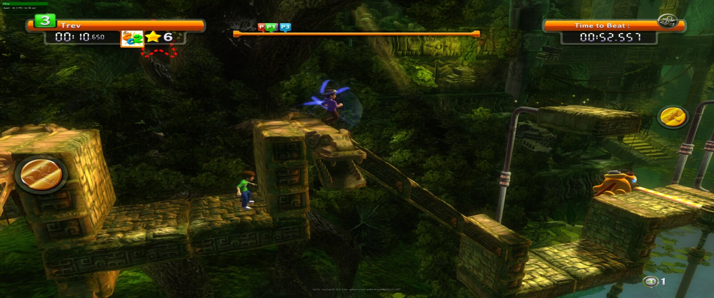
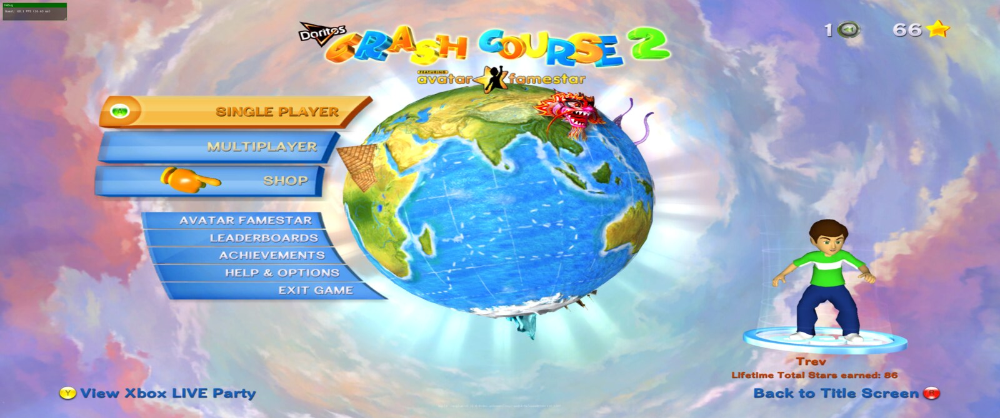

# Crash Course 2 Static Recomp

A native Linux port of **Doritos Crash Course 2** (Xbox Live Arcade, 2011, title ID `5841124F`).
The game's Xbox 360 PowerPC code is statically recompiled to C++ with
[ReXGlue](https://github.com/rexglue/rexglue-sdk), and ReXGlue's runtime (adapted from Xenia)
supplies the Xbox 360 kernel, a Vulkan renderer, audio and controller input. This repository holds
only the game-specific parts: the recompiler configuration, fixes, hooks and extra features.

Crash Course 2 was a free advergame that needed Xbox LIVE to start. The servers are gone and the
game was delisted. This port runs the community **offline build**: Title Update 2 merged and the
offline patches from [crash-course-2-revived](https://github.com/LegendaryFire/crash-course-2-revived)
and [doritos-crash-course-xenia](https://github.com/Lken-cmd/doritos-crash-course-xenia) applied.
It can also share course times through a small leaderboard server you host yourself on
Cloudflare's free plan.

> **Notice:** This repository contains no game data. You need your own copy of the game and its
> title update. Please don't post game files, or links to them, in issues or pull requests.
> This project is not affiliated with Behaviour Interactive, PepsiCo/Doritos or Microsoft.

## Screenshots





*Main menu and a jungle course on an AMD RX 6750 XT under Ubuntu, with the player name set in
`crashcourse2.toml`. The racer is the offline build's stand-in avatar; real Xbox avatars need
Microsoft's avatar service.*

## Status

**Works**

- Boots straight to the menus with no Xbox LIVE sign-in.
- Single player courses, earning stars and buying from the shop.
- A steady 60 fps at 2560×1440 on an RX 6750 XT (RADV), with sound.
- Keyboard or controller, your own player name, the F1 settings menu, the F3 FPS counter and a
  frame limiter.

**Known issues / needs testing**

- This is an early build that has only had a few hours of play. Expect bugs.
- *Help & Options → press A to save and exit* has closed the whole game. This happened before the
  setjmp/longjmp fix and hasn't been retested since.
- Online leaderboards: the server and the in-game connection test work, but a time uploaded from a
  finished course hasn't been seen on the server yet.
- Players race as stand-in models (from the Xenia mod), not their own Xbox avatars.
- Multiplayer has not been tried.

## Download and play

1. Download `CrashCourse2-linux-x64.tar.gz` from **Releases** (when one is published), or build it
   yourself (see below), and extract it.
2. Make the offline game files from your own copy (see *Getting your game files*):
   ```bash
   cd CrashCourse2
   tools/build_offline_game.sh /path/to/your/game  /path/to/TU_1C424IF_000000K000000.00000000000G5  assets
   ```
   This needs Python 3.11+, git, make and g++. The first time it runs, it downloads the two
   MIT-licensed offline-patch projects. It merges the title update, applies the offline patches,
   rebuilds `data.pak` and writes everything into `assets/`.
3. Run `./crashcourse2`.

**Requirements:** 64-bit Linux with glibc 2.38+ (Ubuntu 24.04+, Fedora 39+, Arch), a Vulkan
driver (Mesa RADV/ANV or NVIDIA), X11 or XWayland, and PulseAudio or PipeWire. A controller is
recommended.

**In game**

| Key | What it does |
|---|---|
| F1 (LB+RB+X, or Q+E+X) | Settings: name, online server, graphics, sound, controls. Saves to `crashcourse2.toml` |
| F3 | FPS counter (the log also gets an FPS line every 5 seconds) |
| F4 | Every advanced engine setting |
| Arrows/WASD, Enter/Space, Backspace | Left stick, A, B (full keyboard map in `packaging/README-linux.txt`) |

**Settings** live in `crashcourse2.toml` next to the program. The one most people want is the
player name, which shows up in game and on the leaderboards:

```toml
cc2_player_name = "Trev"
```

**If something goes wrong:** logs go to `logs/` next to the program, and a crash also writes
`crash.txt`. If it crashes a moment after start, or says `default.xex is not the offline build`,
the original executable is still in `assets/`, so redo step 2. The offline `default.xex` is
exactly 15,142,912 bytes. Saves and the shader cache are kept under `~/.local/share/crashcourse2`.

## Getting your game files

No game files are included or linked here.

1. **The game.** Copy the Crash Course 2 package off an Xbox 360 hard drive or USB storage, then
   extract it with Velocity or Horizon. You need `default.xex`, `data.pak`, `ArcadeInfo.xml`,
   `intro.wmv`, `bhvr.wmv` and `AvatarAwards`.
2. **Title Update 2.** The file `TU_1C424IF_000000K000000.00000000000G5`. A console
   that played the game online has it in its title update cache. The offline patches are written
   for this update, so the port needs it.

`tools/build_offline_game.sh` checks both and refuses to build from anything else.

## Online leaderboards (optional)

Crash Course 2's leaderboards (best time per course, all-time and weekly, per world) are routed to
a Cloudflare Worker that you deploy for free in a few minutes. Everyone who sets the same server
address sees each other's times. Setup is in [server/worker/README.md](server/worker/README.md).
After deploying, open F1 → *Player & Online*, enter a name, a password you make up and the
Worker's address, then press **Test connection**.

## Building it yourself

The build runs on Linux and needs clang 20, CMake 3.25+, Ninja and the
[ReXGlue SDK](https://github.com/rexglue/rexglue-sdk) (v0.10) built and installed from source.

```bash
# 1. Offline game files (see above) into game/
tools/build_offline_game.sh /path/to/your/game /path/to/TU_...G5 game

# 2. Recompile the game code (~1.5 minutes), then build (~10 minutes the first time)
rexglue codegen crashcourse2_manifest.toml
cmake --preset linux-amd64-release -DCMAKE_PREFIX_PATH=/path/to/rexsdk-install
cmake --build out/build/linux-amd64-release --parallel

# 3. Package: program + ReXGlue runtime libraries + README, empty assets/ (no game files)
tools/package_linux.sh
```

Generated code (`generated/default/`) and game data are never committed. Both are rebuilt from
your files.

## What's in here

| Path | Purpose |
|---|---|
| `crashcourse2_manifest.toml` | ReXGlue project manifest |
| `cc2_leaf_functions.toml` | Function boundaries the analysis can't infer (no `.pdata`, split functions) |
| `cc2_callback_functions.toml` | ~600 functions reached only through pointers (vtable thunks, callbacks, CRT tables) |
| `cc2_fixes.toml` | Hand-checked fixes: an unbounded jump table, two split functions |
| `cc2_offline_hooks.toml` | setjmp/longjmp redirection and the mid-function hooks for the offline patches |
| `crashcourse2.toml` | Default settings shipped next to the program |
| `src/offline_detours.cpp` | The offline patches' seven mid-function detours, reimplemented as hooks |
| `src/player_name.cpp` | Player name and stable XUID on the `XamUser*` imports |
| `src/online.cpp`, `src/http_client.cpp` | Leaderboard reads and writes sent to the Worker over HTTPS (libcurl) |
| `src/cc2_menu.cpp`, `src/perf_tools.cpp` | F1 menu, FPS counter, frame limiter |
| `src/keyboard_input.cpp`, `src/input_lock.cpp` | Keyboard as controller 1; every pad acts as player 1 |
| `src/game_exit.cpp`, `src/crash_handler.cpp` | Clean exit from the game's own Exit, `crash.txt` |
| `src/usbcam_stubs.cpp` | Xbox LIVE Vision camera reported as not connected |
| `server/worker/` | Cloudflare Worker + D1 leaderboard server |
| `tools/build_offline_game.sh`, `tools/make_offline_game.py` | Build the offline game files from your copy |
| `tools/remap_functions.py` | Map function addresses between two builds of the executable |
| `tools/find_*.py`, `tools/xexdump/` | Analysis helpers: leaf/callback functions, jump tables, XEX decoding |
| `tools/run_game.sh` | Headless test run (Xvfb + lavapipe + PulseAudio null sink, screenshots) |
| `packaging/README-linux.txt` | The README that ships in the release archive |

## Notes for developers

How this port differs from a plain ReXGlue project, and what was learned along the way:

- **Recompiled from the offline build, not the retail one.** Title Update 2 relinked nearly the
  whole executable (the image grew from 0x1370000 to 0x13A0000 bytes), so every address found in
  the retail build moved. `tools/remap_functions.py` matches functions between two images by their
  instructions, ignoring the bits that relocation changes, and it moved every hook across.
- **Offline patches that jump into the middle of functions.** Most of the patches' new code sits
  in two functions they disable and is reached with ordinary calls, so it recompiles normally.
  Seven patches instead branch into that code and branch back into the middle of the caller, which
  a static recompiler can't follow. `make_offline_game.py` restores those seven sites to the
  original instructions, and `src/offline_detours.cpp` does the same work as ReXGlue mid-asm hooks
  (`cc2_offline_hooks.toml`), instruction for instruction.
- **setjmp/longjmp must be redirected.** The game's Lua scripts raise errors as part of normal play,
  and Lua handles them with the CRT's `setjmp`/`longjmp` (0x828D9D30 / 0x828D5AC0 in the TU2 build).
  Run as ordinary guest code, the first script error returned to the wrong place and crashed the
  game as soon as a course started. Trials HD needed the same fix.
- **Xbox LIVE.** The game refuses to start without a LIVE profile. The offline patches remove that
  check. The port's own LIVE emulation from the first attempt is gone; only the leaderboard calls
  are intercepted.
- **Leaderboard calls.** The XDK wrappers were found by the XGI message each sends through
  `XMsgStartIORequest` (WriteStats `0xB0025`, FlushStats `0xB0026`, Leave `0xB0013`, and the three
  `XamUserCreateStatsEnumerator` types). The view layout comes from the XLAST embedded in the
  game's SPA: 171 views, each one rating column, higher is better.
- **Analysis help.** ReXGlue found every jump table except one unbounded byte table (pinned in
  `cc2_fixes.toml`). About a dozen leaf functions with no `.pdata` entry, plus ~600 functions reached
  only by pointer, are listed by the `tools/find_*.py` scripts, which are reused from the Doritos
  Crash Course port.
- **Diagnostics.** Script errors are logged as `[parse] error: ...`. A quit the game asked for is
  logged as `[exit] ...`.
- **Speed settings from Trials HD.** Host occlusion queries and memexport readback are off by
  default (`crashcourse2.toml`). Both make the CPU wait on the GPU.

## Credits and licence

- [ReXGlue SDK](https://github.com/rexglue/rexglue-sdk) (BSD-3-Clause), which includes code from
  the [Xenia](https://xenia.jp) project (BSD-3-Clause). See [NOTICE.md](NOTICE.md).
- The offline patches and stand-in avatar models come from
  [crash-course-2-revived](https://github.com/LegendaryFire/crash-course-2-revived) and
  [doritos-crash-course-xenia](https://github.com/Lken-cmd/doritos-crash-course-xenia) (both MIT).
  They are downloaded when you build the game files, not copied into this repository.
- Doritos Crash Course 2 is © its rights holders (developed by Behaviour Interactive for PepsiCo).
  This project is unofficial and not affiliated with them or with Microsoft.
- The code in this repository is under the MIT licence ([LICENSE](LICENSE)).
